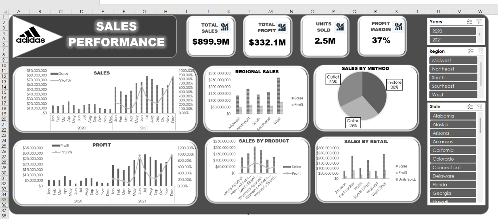

# 👟 Adidas Sales Performance Analysis | Excel Dashboard

## 📌 Project Overview

This project focuses on analyzing Adidas sales performance using **Microsoft Excel**. The goal is to transform raw sales data into meaningful business insights through data cleaning, analysis, PivotTables, PivotCharts, and an interactive dashboard.

The analysis explores sales trends, operating profit, product performance, regional performance, retailer contributions, and sales methods to support better business decision-making.

## 🎯 Project Objectives

- Analyze overall Adidas sales performance.
- Identify the best-performing product categories.
- Compare sales and profit across different regions.
- Evaluate retailer performance.
- Understand sales trends over time.
- Compare monthly sales performance between 2020 and 2021.
- Present findings through an interactive Excel dashboard.
- Provide data-driven business recommendations.

## 🛠️ Tools and Technologies

| Tool | Purpose |
|---|---|
| 📊 Microsoft Excel | Data analysis and dashboard creation |
| 🧹 Excel Data Cleaning | Preparing and organizing the dataset |
| 📌 PivotTables | Summarizing and analyzing sales data |
| 📈 PivotCharts | Visualizing sales trends and performance |
| 🎛️ Slicers and Filters | Interactive dashboard exploration |
| 🐙 GitHub | Project documentation and portfolio presentation |

## 📂 Dataset Description

The dataset used for this project was obtained from **Kaggle**, an online platform for datasets and data science projects.

It contains Adidas sales records used to analyze business performance across different product categories, regions, retailers, and sales methods.

### 📊 Dataset Features

- 📅 Invoice Date
- 🏬 Retailer
- 🌍 Region
- 📍 State and City
- 👟 Product Category
- 💰 Total Sales
- 📦 Units Sold
- 💵 Operating Profit
- 🛒 Sales Method

### 🔗 Dataset Source

**Source:** Kaggle

[View the Adidas Sales Dataset on Kaggle](https://www.kaggle.com/datasets/ahmedmohamed2003/cafe-sales-dirty-data-for-cleaning-training)

## 🔍 Data Analysis Process

### 1. 🧹 Data Preparation
- Inspected the dataset.
- Checked data consistency.
- Organized columns and formatted values.
- Prepared the data for analysis.

### 2. 📊 Exploratory Data Analysis
- Reviewed total sales and operating profit.
- Compared product categories.
- Analyzed regional performance.
- Evaluated retailer contributions.
- Examined sales methods and monthly trends.

### 3. 📈 Dashboard Development
- Created PivotTables to summarize the data.
- Built charts to communicate key findings.
- Added interactive filters and slicers.
- Designed a dashboard to make business performance easier to understand.

## 📸 Dashboard Preview

## 📌 Key Performance Indicators (KPIs)

| KPI | Result |
|---|---:|
| 💵 Total Sales | $899.9M |
| 💰 Operating Profit | $332.1M |
| 📦 Units Sold | Approximately 2.5M |
| 📊 Profit Margin | Approximately 37% |

## 💡 Key Insights

1. 👟 **Top Product Category:** Men's Street Footwear was identified as a leading product category.
2. 🌎 **Top Region:** The West region recorded the strongest sales performance.
3. 🏬 **Top Retailer:** West Gear was identified as a leading retailer.
4. 📈 **Sales Trends:** Monthly sales and operating profit comparisons between 2020 and 2021 help reveal changes in business performance.
5. 💰 **Profitability:** The analysis highlights the relationship between sales revenue and operating profit.

## 🚀 Business Recommendations

- Focus on high-performing product categories to maintain sales growth.
- Study successful regions and retailers to identify practices that can be applied elsewhere.
- Improve marketing and promotional strategies for lower-performing categories.
- Use monthly sales trends to plan inventory and seasonal promotions.
- Monitor operating profit alongside revenue to support sustainable growth.
- Evaluate sales methods to identify opportunities for improved performance.

## 📚 Project Deliverables

- ✅ Prepared Adidas sales dataset.
- ✅ Excel-based sales analysis.
- ✅ PivotTables and PivotCharts.
- ✅ Interactive sales dashboard.
- ✅ Key business insights.
- ✅ Business recommendations.
- ✅ GitHub project documentation.

## 👩‍💻 Skills Demonstrated

- Data cleaning and preparation
- Microsoft Excel
- Data analysis
- PivotTables and PivotCharts
- KPI reporting
- Dashboard design
- Business intelligence
- Data storytelling

## 👋 Conclusion

This project demonstrates how Microsoft Excel can be used to transform sales data into useful business insights. Through data analysis and dashboard visualization, the project provides a clearer understanding of Adidas sales performance, profitability, product categories, and regional contributions.

---

⭐ **Thank you for visiting this project!**

If you find this project useful, feel free to ⭐ star the repository.# Adidas-Sales-Analysis
Adidas sales performance analysis and interactive Excel dashboard.
